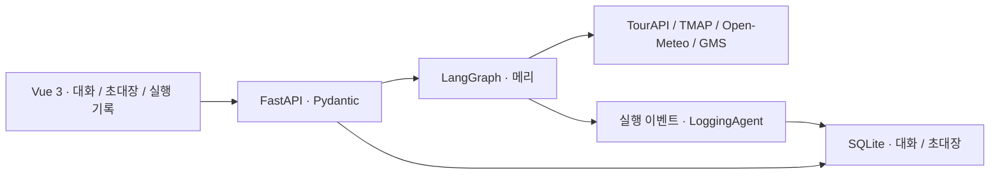

# Dear. Me — 나에게 도착한 크리스마스


**SSAFY AI 코어 프로젝트 3회차 · Agent 기반 도메인 플래너**

Dear. Me는 메리와 대화해 **지하철역 근처에서 걸을 수 있는 크리스마스 코스**를 만들고, 편지 형태의 초대장으로 받는 서비스입니다. 예를 들어 “강남역 근처에서 친구랑 17:30부터 21:30까지 양식 저녁 먹고 카페 가고 싶어”라고 말하면, Agent가 역 주변 후보를 찾고 영업 정보와 구간별 보행 시간을 확인해 순서를 정합니다.

## 사용 방법

1. 대화창에 역 이름, 시간대, 하고 싶은 일을 입력하고 Enter를 누릅니다. “도보 10분 이내로 바꿔 줘”처럼 후속 요청으로 일부 조건만 수정할 수 있습니다.
2. 트리 위에 도착한 봉투를 열어 지도, 방문 순서, 제안 체류 시간, 장소 정보를 확인합니다.
3. 초대장을 보관함에 저장해 일정 충돌을 확인하거나 수정·삭제합니다. 링크를 받은 사람은 트리와 대화창이 있는 메인 화면 위에 열린 편지 모달에서 일정을 읽을 수 있습니다.
4. 실행 기록에서 Agent의 Tool 호출, 판단 사유, 재계획 횟수를 확인합니다.

## 요구사항과 구현

| 구분 | 구현 |
| --- | --- |
| F3001–F3004 외부 Tool | TourAPI 후보와 상세, TMAP 역·식당·카페 검색 및 도보 경로, Open-Meteo 과거 날씨를 네 Tool로 등록 |
| F3005–F3011 계획 Agent | 기준과 선호를 추출하고, Tool 결과로 시간·거리·이용 조건을 계산해 판단. 필요하면 기본 3회까지 재계획하고, 대화 맥락과 초대장 응답 제공 |
| F3012–F3016 로그·보관함 | 단계 이벤트를 별도 LoggingAgent로 기록. 로그 조회·삭제와 초대장 저장·조회·수정·삭제 및 중복 감지 |
| F3017–F3019 서비스·화면 | FastAPI/Pydantic API, Vue 3 대화·보관함·실행 기록, 진행 상태·실패·재계획 표시 |
| NF3001–NF3007 비기능 | 환경 변수, 오류 정제, 실패 격리, 재계획 상한, 응답시간 측정, 모듈 분리, 외부 API 출처·이용 조건 문서화 |
| 서비스 확장 | 카카오톡 공유와 읽기 전용 초대장, ASCII 트리·산타·모닥불, 배경음 |
| 과제 선택 심화 F3020–F3023 | 이상 진단, Planner·Worker 분리, 문서 검색, 캘린더 연동은 미구현 |

실연동에서는 **역 반경 1.2km** 안에서 후보를 찾고 확인된 도보 한 구간은 **30분 이내**로 제한합니다. 점심·저녁 시간대와 일정 길이에 맞춰 식당, 카페, 활동을 조합하고, 등록된 프랜차이즈 카페 패턴과 동일 건물의 반복 방문을 줄입니다. 장소 사진은 제공되는 경우 출처를 표시합니다. 자세한 요구사항과 확인 근거는 [요구사항 정의서](docs/requirements.md)에 정리했습니다.

## 구성



프론트엔드는 Vue 3·Vite·Leaflet·Canvas·Web Audio, 백엔드는 Python·FastAPI·Pydantic·LangGraph·SQLite를 사용합니다.

## 실행

Python 3.12와 Node.js 24에서 확인했습니다. 백엔드 최소 기준은 Python 3.10, 프론트엔드 빌드에는 Node.js 20.19+ 또는 22.12+가 필요합니다.

~~~powershell
python -m venv .venv
.venv/Scripts/python.exe -m pip install -r requirements.txt
npm.cmd --prefix frontend ci
npm.cmd --prefix frontend run build
.venv/Scripts/python.exe -m uvicorn backend.main:app --host 127.0.0.1 --port 8000
~~~

- 앱은 [http://127.0.0.1:8000](http://127.0.0.1:8000), API 문서는 [Swagger UI](http://127.0.0.1:8000/docs)에서 엽니다.
- 키 없이 전체 계획 흐름을 보려면 **예시 초대장 받아보기**를 누르세요. 서울 종로를 배경으로 한 가상 장소·경로·날씨를 사용합니다.
- 프론트엔드 개발 시 별도 터미널에서 `npm.cmd --prefix frontend run dev`를 실행합니다. Vite가 API 요청을 8000번 포트로 전달합니다.
- SQLite 기본 파일은 `data/dear-me.sqlite3`입니다. 폴링 실행과 경로 미리보기는 서버 메모리에 있으므로 Uvicorn 워커는 한 개로 실행합니다.
- `requirements.txt`는 필수 기능에 필요한 PDF 지정 버전을 설치합니다. 전체 명세 버전은 `requirements.pdf.txt`에 있습니다.

## 컨테이너 배포

```powershell
docker build -t dear-me .
docker run --rm --env-file .env --env DATABASE_PATH=/data/dear-me.sqlite3 --env PORT=8000 --publish 127.0.0.1:8000:8000 --mount source=dear-me-data,target=/data dear-me
```

호스팅 환경에서는 단일 인스턴스에 영구 디스크를 `/data`로 연결하고 상태 확인 경로를 `/healthz`로 설정합니다. API 키는 호스팅 서비스의 런타임 비밀 변수로 등록합니다. 보관함과 실행 기록은 인스턴스 전체에서 공유하므로 배포 시 신뢰할 수 있는 사용자만 접근하도록 호스팅 서비스에서 접근을 제한합니다.

### Render 무료 시연 배포

소스 저장소를 Render에 연결하고 루트의 `render.yaml`을 Blueprint로 사용합니다. 무료 Docker 웹 서비스가 열리면 **예시 초대장 받아보기**로 코스를 시연할 수 있습니다. 실연동이 필요하면 Render에서 아래 API 키를 비밀 변수로 등록합니다. 이 구성에는 영구 디스크가 없으므로 재시작 시 보관함이 초기화됩니다.

## 실연동 설정

`.env.example`을 `.env`로 복사한 뒤 다음 값을 입력하고 서버를 재시작합니다.

| 변수 | 설정 |
| --- | --- |
| `TOUR_API_KEY` | 한국관광공사 국문 관광정보 서비스 활용 신청 후 발급된 일반 인증키 |
| `TMAP_APP_KEY` | SK open API TMAP 프로젝트 App Key. 보행 경로와 부족한 카페 후보 검색에 사용해요. |
| `GMS_KEY` | SSAFY GMS에서 발급한 API 키 |
| `GMS_BASE_URL` | `https://gms.ssafy.io/gmsapi/api.openai.com/v1` |
| `GMS_MODEL` | `gpt-6.1-sol` |
| `MAX_REPLANS` | 기본 3회, 설정 범위 0~8 |
| `LOGGING_ENABLED` | 기본 true. false를 지정하면 장기 로그 저장 없이 진행 상태를 표시 |
| `DATABASE_PATH` | 선택 SQLite 파일 경로 |
| `KAKAO_JS_KEY` | 선택 카카오디벨로퍼스 JavaScript 키. 카카오톡 초대장 공유에 사용 |

LLM 요청은 `GMS_BASE_URL`에 `/responses`를 붙인 주소로 전송합니다.

카카오톡으로 보내려면 카카오디벨로퍼스 앱의 **JavaScript SDK 도메인**과 **제품 링크 관리 → 웹 도메인**에 서비스의 공개 HTTPS 주소를 등록합니다. 같은 서비스의 환경에 `KAKAO_JS_KEY`를 설정한 뒤, 초대장을 저장하고 **카카오톡 공유**를 누릅니다. 공유 이미지에는 `frontend/public/invitation-share.png`를 사용합니다. 공유 링크의 열람 가능 기간은 보관함에 초대장이 남아 있는 기간과 같습니다. [카카오톡 공유 설정 안내](https://developers.kakao.com/docs/ko/tutorial/js-share)

`.venv/Scripts/python.exe scripts/verify_apis.py`로 실호출을 확인합니다. 이전 검증 결과와 공급자별 신청 절차는 [기획 검증](docs/domain-verification.md)에 있습니다. [공공데이터포털](https://www.data.go.kr/data/15101578/openapi.do) · [SK open API](https://openapi.sk.com/products/detail?linkMenuSeq=24) · [SSAFY GMS](https://gms.ssafy.io/web/)

외부 데이터는 TourAPI의 등록·공개 이용 정보, TMAP의 도보 경로와 POI, Open-Meteo의 과거 관측 기반 자료를 사용합니다. 공휴일 실제 운영은 방문 전에 확인해야 하며, TMAP 파생 데이터는 단기 메모리로 제공합니다. 출처와 이용 조건은 [서비스별 이용 조건](docs/domain-verification.md#출처-및-이용-조건)에 정리했습니다.

## 제출 자료

- [요구사항 정의서](docs/requirements.md) · [Agent 설계](docs/agent.md) · [Tool 정의](docs/tools.md) · [API 명세](docs/api.md)
- [기획 검증](docs/domain-verification.md) · [검증 결과](docs/verification.md) · [자체 체크리스트](docs/self-checklist.md)
- [정상 전체 실행 로그](docs/evidence/scenarios/normal.json) · [재계획 전체 실행 로그](docs/evidence/scenarios/replan.json) · [화면 증빙](docs/evidence/screens)
- lab.ssafy.com 제출에는 README, 연결 문서, 소스 및 증빙을 포함합니다. 배포는 시연용 Render 설정을 포함하며, 저장한 초대장과 공유 링크는 서버의 보관함이 유지되는 동안 열 수 있습니다.
